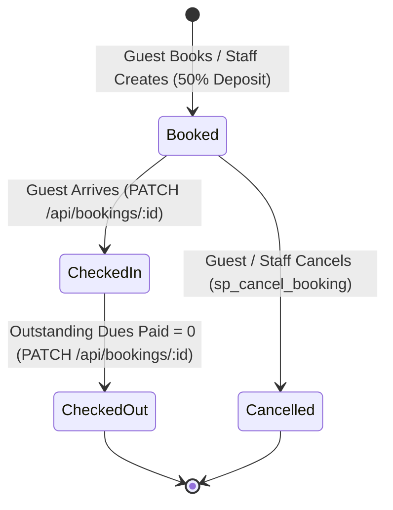

Viewed app.js:1-65

# SkyNest Hotels Backend API Architecture & Endpoints Guide

The backend follows a **RESTful architecture** with strict **Role-Based Access Control (RBAC)**, database-driven business logic, and real-time WebSocket notifications.

---

## 1. Core API Design Principles

1. **Security & Identification (UUID vs Internal Integer ID)**:
   - All client-facing endpoints use cryptographically random **UUIDs** (`public_id`) in URL paths (e.g., `/api/bookings/e978288c-c74c-11f1-9529-cefd4c5f953e`).
   - Clients are strictly barred from querying or seeing internal auto-increment primary keys (`booking_id`, `guest_id`, `room_id`) to prevent **IDOR (Insecure Direct Object Reference)** and enumeration attacks.
2. **ACID Transactions**:
   - Write endpoints acquire a dedicated connection from the `mysql2` pool, open a transaction with `await connection.beginTransaction()`, apply row-level locks (`SELECT ... FOR UPDATE`), and commit or roll back.
3. **Role-Based Access Control (RBAC)**:
   - Endpoints are protected by middleware checking session cookies:
     - **Public**: Anyone (browsing rooms, hotel config, signing up).
     - **Guest**: Authenticated guests bound to their own `guest_id`.
     - **Front Desk / Manager / Admin**: Hotel staff authorized for operations and reporting.
4. **Event-Driven Staff Alerts**:
   - Write endpoints trigger `notifyStaff()` over **Socket.IO** so staff dashboards update instantly without page reloads.

---

## 2. Authentication & Account Recovery (`/api/auth`)

Mounted in [`src/app.js`](file:///home/vidathd/Documents/UoM/Year%202/Semester%203/CS3043%20Database%20Systems/backend/src/app.js#L36-L40):

| Method & Route | Auth Required | Handler File | Description & Workflow |
| :--- | :--- | :--- | :--- |
| **`POST /api/auth/guest-sign-up`** | Public | [`guest-auth.routes.js`](file:///home/vidathd/Documents/UoM/Year%202/Semester%203/CS3043%20Database%20Systems/backend/src/routes/guest-auth.routes.js) | **Dual-Entity Guest Registration**: Atomically creates a hotel guest record in `guest` table AND an authentication user in Better Auth's `user` table, linked via `user.guestPublicId`. Automatically issues an active session cookie. |
| **`POST /api/auth/sign-in/email`** | Public | Better Auth Engine | Authenticates staff or guests via email and hashed password (bcrypt). Returns an `httpOnly` secure session cookie. |
| **`POST /api/auth/sign-out`** | Authenticated | Better Auth Engine | Invalidates the session token in the `session` table and clears the client cookie. |
| **`GET /api/auth/get-session`** | Authenticated | Better Auth Engine | Returns current session status, user role, and linked profile identifier. |
| **`POST /api/auth/forgot-password`** | Public | [`auth-recovery.routes.js`](file:///home/vidathd/Documents/UoM/Year%202/Semester%203/CS3043%20Database%20Systems/backend/src/routes/auth-recovery.routes.js) | Generates a secure password reset token in the `verification` table for registered emails. |
| **`POST /api/auth/reset-password-direct`** | Public | [`auth-recovery.routes.js`](file:///home/vidathd/Documents/UoM/Year%202/Semester%203/CS3043%20Database%20Systems/backend/src/routes/auth-recovery.routes.js) | Consumes the reset token from `verification` table and updates the account's hashed password. |
| **`POST /api/auth/admin/create-user`** | Admin Only | Better Auth Admin | Allows administrators to provision staff accounts (`manager`, `front_desk`). |

---

## 3. Public Portal Endpoints (Unauthenticated)

Mounted in [`src/app.js`](file:///home/vidathd/Documents/UoM/Year%202/Semester%203/CS3043%20Database%20Systems/backend/src/app.js#L48-L60) and implemented in [`data.routes.js`](file:///home/vidathd/Documents/UoM/Year%202/Semester%203/CS3043%20Database%20Systems/backend/src/routes/data.routes.js):

| Method & Route | Query Parameters | Description & Database Action |
| :--- | :--- | :--- |
| **`GET /api/rooms`** | `check_in`, `check_out`, `branch_public_id`, `room_type_public_id`, `guests` | **Room Search & Availability Engine**: Runs an anti-overlap query to find rooms not reserved in `booking_room` for the given dates, grouped with branch name, room type details, and amenities. |
| **`GET /api/hotel-config`** | None | Returns branding config (hotel name, hotline number, check-in/out policies, currency) from `hotel_config`. |
| **`GET /api/payment-methods`** | None | Returns active payment methods (`Card`, `Cash`, `Bank Transfer`, etc.) from `payment_method`. |
| **`GET /api/health`** | None | Liveness health check (`{ status: "ok" }`). Used by deployment scripts and Oracle Cloud load balancers. |

---

## 4. Guest Self-Service Endpoints (`/api/guest`)

Mounted under `/api/guest` in [`src/app.js`](file:///home/vidathd/Documents/UoM/Year%202/Semester%203/CS3043%20Database%20Systems/backend/src/app.js#L62) and handled in [`guest.routes.js`](file:///home/vidathd/Documents/UoM/Year%202/Semester%203/CS3043%20Database%20Systems/backend/src/routes/guest.routes.js). All endpoints require an active `guest` session and automatically scope queries to `req.guest.guest_id`:

| Method & Route | Request Body | Description & Database Transaction |
| :--- | :--- | :--- |
| **`GET /api/guest/profile`** | None | Retrieves the profile (first name, last name, email, phone) of the logged-in guest. |
| **`GET /api/guest/bookings`** | None | Returns all reservations for the guest with room numbers, branch names, billing summary, and paid amounts. |
| **`GET /api/guest/bookings/:publicId`** | None | Detailed view of a single reservation including full bill calculation and services breakdown. |
| **`POST /api/guest/bookings`** | `room_public_ids`, `check_in_time`, `check_out_time`, `payment_method` | **Reservation + Mandatory 50% Advance Payment**: An atomic transaction that: (1) locks rooms `FOR UPDATE`, (2) verifies date overlap, (3) inserts `booking` and `booking_room`, (4) creates payment for exactly 50% deposit, (5) calls `sp_calculate_bill`, and (6) commits. |
| **`POST /api/guest/bookings/:publicId/cancel`** | None | **Cancellation Engine**: Invokes `sp_cancel_booking`, which dynamically evaluates notice hours against `cancellation_policy`, sets fees, liberates rooms (`booking_availability = 1`), and recalculates bill. |
| **`GET /api/guest/bookings/:publicId/services`** | None | Lists room service requests (meals, laundry, spa) placed for this booking. |
| **`POST /api/guest/bookings/:publicId/services`** | `service_public_id`, `room_public_id`, `quantity` | Orders a service from the catalogue. Inserts `service_usage` with `status = 'Pending'` and recalculates the bill. |
| **`DELETE /api/guest/service-requests/:publicId`** | None | Cancels an unfulfilled (`Pending`) service request and deducts it from the bill. |
| **`POST /api/guest/bookings/:publicId/payments`** | `amount`, `payment_method`, `phone_number` | Records an incremental payment against outstanding dues, calls `sp_calculate_bill`, and triggers an SMS confirmation. |

---

## 5. Staff Operational Endpoints (`/api`)

Handled in [`write.routes.js`](file:///home/vidathd/Documents/UoM/Year%202/Semester%203/CS3043%20Database%20Systems/backend/src/routes/write.routes.js) and restricted to `admin`, `manager`, or `front_desk`:

### A. Booking Lifecycle Management

| Method & Route | Allowed Roles | Description & Database Enforcements |
| :--- | :--- | :--- |
| **`POST /api/bookings`** | Staff | Manual booking creation for walk-in or phone reservations. Validates multi-branch room rules and date overlaps. |
| **`PATCH /api/bookings/:publicId`** | Staff | **State Transition & Dates**: Updates dates or changes `booking_status`:  &bull; `Checked-In`: Automatically triggers room status to Occupied (`current_status = 1, booking_availability = 0`).  &bull; `Checked-Out`: Calls `sp_calculate_bill` and enforces `outstanding_amount == 0` (blocked if dues remain). Frees room (`booking_availability = 1`). |
| **`DELETE /api/bookings/:publicId`** | Admin / Manager | Hard delete: Cascades removal of child records (`service_usage`, `payment`, `booking_room`, `notification_outbox`) and the booking itself. |
| **`POST /api/bookings/:publicId/payments`** | Staff | Records a physical cash, POS card, or bank settlement. Invokes `sp_calculate_bill`. |
| **`POST /api/bookings/:publicId/services`** | Staff | Records a service used by a guest while checked-in. |

### B. Catalog & Guest Entity Management
| Method & Route | Allowed Roles | Description |
| :--- | :--- | :--- |
| **`POST /api/guests`** | Staff | Creates a guest profile in the database. |
| **`PATCH /api/guests/:publicId`** | Staff | Updates guest contact info (phone, email, name). |
| **`POST /api/services`** | Admin / Manager | Adds a new service to `service_catalogue`. |
| **`PATCH /api/services/:publicId`** | Admin / Manager | Updates service description or price (trigger logs `price_update_time`). |
| **`DELETE /api/services/:publicId`** | Admin / Manager | Removes a service (rejected by FK if usage records reference it). |

---

## 6. Staff Analytical & Reporting Endpoints (`/api`)

Handled in [`data.routes.js`](file:///home/vidathd/Documents/UoM/Year%202/Semester%203/CS3043%20Database%20Systems/backend/src/routes/data.routes.js). These endpoints query the 5 SQL views defined in [`init.js`](file:///home/vidathd/Documents/UoM/Year%202/Semester%203/CS3043%20Database%20Systems/backend/db/init.js#L330-L459):

| Endpoint Route | Underlying SQL View | What it Computes |
| :--- | :--- | :--- |
| **`GET /api/reports/occupancy`** | [`report_occupancy`](file:///home/vidathd/Documents/UoM/Year%202/Semester%203/CS3043%20Database%20Systems/backend/db/init.js#L331-L350) | Room utilization and occupancy state per branch. |
| **`GET /api/reports/billing`** | [`report_guest_billing`](file:///home/vidathd/Documents/UoM/Year%202/Semester%203/CS3043%20Database%20Systems/backend/db/init.js#L352-L382) | Summary of total charges, payments received, and outstanding debts per guest. |
| **`GET /api/reports/service-usage`** | [`report_service_usage`](file:///home/vidathd/Documents/UoM/Year%202/Semester%203/CS3043%20Database%20Systems/backend/db/init.js#L384-L404) | Audit log of room service consumption with price snapshots. |
| **`GET /api/reports/revenue`** | [`report_revenue`](file:///home/vidathd/Documents/UoM/Year%202/Semester%203/CS3043%20Database%20Systems/backend/db/init.js#L406-L445) | Branch-wise revenue breakdown separating room revenue, tax revenue, and service revenue. |
| **`GET /api/reports/top-services`** | [`report_top_services`](file:///home/vidathd/Documents/UoM/Year%202/Semester%203/CS3043%20Database%20Systems/backend/db/init.js#L447-L458) | Most popular hotel services ranked by usage quantity and revenue generated. |

---

## 7. System & Hotel Management Settings (`/api/management`)

Mounted in [`src/app.js`](file:///home/vidathd/Documents/UoM/Year%202/Semester%203/CS3043%20Database%20Systems/backend/src/app.js#L51-L60) and implemented in [`data.routes.js`](file:///home/vidathd/Documents/UoM/Year%202/Semester%203/CS3043%20Database%20Systems/backend/src/routes/data.routes.js#L198-L290). Backed by the `hotel_config` table:

| Method & Route | Auth & Roles | Request / Response Format | Description & Database Action |
| :--- | :--- | :--- | :--- |
| **`GET /api/management/settings`** | Staff (`admin`, `manager`, `front_desk`, `service_staff`) | Returns `{ data: { hotelName, contactEmail, contactPhone, checkInTime, checkOutTime, revision } }` | Queries `hotel_config` and maps rows into a strongly-typed operational configuration DTO for staff dashboards. |
| **`PUT /api/management/settings`** | Management (`admin`, `manager`) | Body: `{ hotelName, contactEmail, contactPhone, checkInTime, checkOutTime, revision }` | Validates input, executes an atomic transaction with `ON DUPLICATE KEY UPDATE` across `hotel_config`, increments `settings_revision` for optimistic concurrency, and emits `settings:updated` over WebSockets. |

---

## 8. Master Viva Cheat Sheet: Key Endpoints at a Glance

| Scenario | Primary Endpoint | Underlying DB Mechanism |
| :--- | :--- | :--- |
| **Guest Books Room** | `POST /api/guest/bookings` | Locks rooms `FOR UPDATE`, enforces 50% deposit, triggers `sp_calculate_bill`. |
| **Guest Cancels** | `POST /api/guest/bookings/:id/cancel` | Calls `sp_cancel_booking`, evaluates `cancellation_policy`, frees room. |
| **Staff Check-In** | `PATCH /api/bookings/:id` (`booking_status: 'Checked-In'`) | `AFTER UPDATE` trigger updates `room.current_status = 1, booking_availability = 0`. |
| **Staff Check-Out** | `PATCH /api/bookings/:id` (`booking_status: 'Checked-Out'`) | Trigger blocks if `outstanding_amount > 0`. On success, frees room (`availability = 1`). |
| **Guest Pays Dues** | `POST /api/guest/bookings/:id/payments` | Records payment, runs `sp_calculate_bill`, dispatches SMS notification. |
| **Admin Settings** | `PUT /api/management/settings` | Atomic `ON DUPLICATE KEY UPDATE` in `hotel_config`, increments revision, emits WebSocket. |
| **Occupancy Report** | `GET /api/reports/occupancy` | Queries SQL view `report_occupancy` with zero data mutation. |