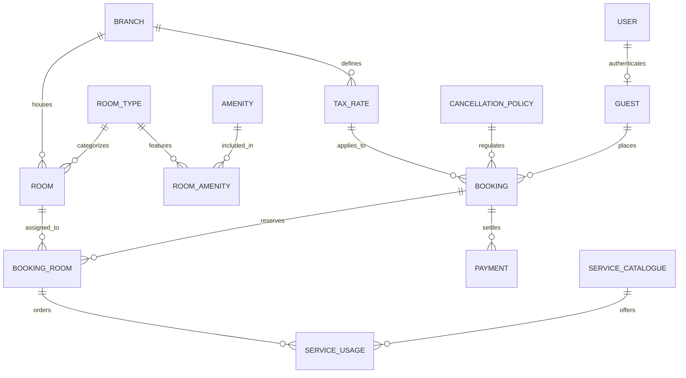

# Comprehensive Viva Preparation Guide: SkyNest Hotels HRGSMS Backend & Database Systems (CS3043)

This master guide prepares you for your **CS3043 Database Systems** viva. It connects relational database theory (normalization, ACID transactions, locking, integrity constraints) directly to the implementation in SkyNest Hotels HRGSMS.

---

## 1. Study Roadmap: Files to Inspect (In Recommended Order)

| Priority | File Path | Focus Area & What to Look For |
| :--- | :--- | :--- |
| **1** | [`backend/db/init.js`](file:///home/vidathd/Documents/UoM/Year%202/Semester%203/CS3043%20Database%20Systems/backend/db/init.js) | **Relational Schema & Views**: Table definitions, Primary/Foreign Keys, Data Types, 5 Analytical SQL Views (`report_occupancy`, `report_guest_billing`, etc.). |
| **2** | [`backend/db/triggers.js`](file:///home/vidathd/Documents/UoM/Year%202/Semester%203/CS3043%20Database%20Systems/backend/db/triggers.js) | **Procedural SQL**: The two stored procedures (`sp_calculate_bill`, `sp_cancel_booking`), 4 validation triggers, room availability sync triggers, and price update audit triggers. |
| **3** | [`backend/db/test-triggers.js`](file:///home/vidathd/Documents/UoM/Year%202/Semester%203/CS3043%20Database%20Systems/backend/db/test-triggers.js) | **Integrity Verification**: 30 automated test cases proving constraints (anti-overlap, branch consistency, checkout dues guard, overpayment credit). |
| **4** | [`backend/src/routes/guest.routes.js`](file:///home/vidathd/Documents/UoM/Year%202/Semester%203/CS3043%20Database%20Systems/backend/src/routes/guest.routes.js) | **Business Logic (Guest)**: Mandatory 50% deposit atomic transaction, guest cancellation, room conflict checking, and Better Auth linkage. |
| **5** | [`backend/src/routes/write.routes.js`](file:///home/vidathd/Documents/UoM/Year%202/Semester%203/CS3043%20Database%20Systems/backend/src/routes/write.routes.js) | **Business Logic (Staff)**: Check-in, Check-out enforcement, recording payments, service usage billing, and row locking (`FOR UPDATE`). |
| **6** | [`backend/src/config/db.js`](file:///home/vidathd/Documents/UoM/Year%202/Semester%203/CS3043%20Database%20Systems/backend/src/config/db.js) | **Connection Pool**: `mysql2/promise` pool configuration, connection limits, and transaction connection handling. |

---

## 2. Database Theory & Architecture



### A. Normalization (1NF through BCNF)
1. **1NF (First Normal Form)**:
   - All attributes are atomic. There are no repeating groups or comma-separated lists.
   - *Example*: Amenities are not stored as a comma-delimited string in `room_type`. Instead, they are decomposed into `amenity` and the bridge table `room_amenity`.
2. **2NF (Second Normal Form)**:
   - Must be in 1NF, and no non-key attribute is partially dependent on any candidate key.
   - *Example*: In `booking_room(booking_id, room_id)`, the attribute `nightly_rate_at_booking` depends on both the room and that specific booking reservation, not just part of the composite primary key.
3. **3NF (Third Normal Form)**:
   - Must be in 2NF, and no transitive functional dependencies exist ($X \to Y \to Z$).
   - *Example*: A room does not store the tax rate directly ($Room \to Branch \to TaxRate$). The tax rate is obtained from `branch` through `tax_rate`.
4. **BCNF (Boyce-Codd Normal Form)**:
   - Every determinant must be a candidate key.

### B. Deliberate Denormalization for Temporal Consistency (Historical Integrity)
A classic viva question: *"Why do `booking`, `booking_room`, and `service_usage` store rates that already exist in `tax_rate`, `room_type`, and `service_catalogue`?"*

> **Viva Answer**:
> This is **Temporal Snapshotting (Historical Preservation)**. Hotel room prices and government tax rates fluctuate over time. If a guest booked a room in 2025 at 15,000 LKR/night with 12% VAT, and the hotel updates the price in 2026 to 20,000 LKR and VAT to 18%, recalculating the bill dynamically from the catalogue would retroactively alter the guest's contracted historical bill. 
> To satisfy legal and financial integrity, snapshot columns (`tax_rate_at_booking`, `nightly_rate_at_booking`, `price_at_usage`, `tax_rate_at_usage`) freeze the financial terms at the moment of commitment.

---

## 3. Deep Dive: Triggers & Procedural Logic

All triggers in [`backend/db/triggers.js`](file:///home/vidathd/Documents/UoM/Year%202/Semester%203/CS3043%20Database%20Systems/backend/db/triggers.js) run inside the database engine.

### 1. `sp_calculate_bill(IN p_booking_id INT)` ([Line 4](file:///home/vidathd/Documents/UoM/Year%202/Semester%203/CS3043%20Database%20Systems/backend/db/triggers.js#L4-L63))
The single source of financial truth. It calculates totals and updates payment statuses:

```sql
SELECT COALESCE(SUM(nightly_rate_at_booking * v_nights), 0)
  INTO v_room FROM booking_room WHERE booking_id = p_booking_id;

SELECT COALESCE(SUM(quantity * price_at_usage), 0),
       COALESCE(SUM(ROUND(quantity * price_at_usage * tax_rate_at_usage, 2)), 0)
  INTO v_service, v_tax FROM service_usage WHERE booking_id = p_booking_id;

-- If Cancelled, room charge is replaced by the cancellation fee
IF v_status = 'Cancelled' THEN
  SET v_room = v_fee;
  IF NOT v_charge_services THEN
    SET v_service = 0;
    SET v_tax = 0;
  END IF;
  SET v_tax = v_tax + v_fee_tax;
ELSE
  SET v_tax = v_tax + ROUND(v_room * v_rate, 2);
END IF;

-- Net calculations
SET v_total = v_room + v_service + v_tax;
UPDATE booking SET 
  total_charge = v_total, 
  total_tax_amount = v_tax,
  outstanding_amount = GREATEST(v_total - v_paid, 0),
  credit_amount = GREATEST(v_paid - v_total, 0),
  payment_status = CASE
    WHEN v_paid > v_total THEN 'Credit Due'
    WHEN v_paid = v_total THEN 'Paid'
    WHEN v_paid > 0 THEN 'Partially Paid'
    ELSE 'Unpaid' END
WHERE booking_id = p_booking_id;
```

### 2. `sp_cancel_booking(IN p_booking_id INT)` ([Line 65](file:///home/vidathd/Documents/UoM/Year%202/Semester%203/CS3043%20Database%20Systems/backend/db/triggers.js#L65-L113))
Evaluates the notice period against `cancellation_policy`:
- Computes notice seconds: `TIMESTAMPDIFF(SECOND, v_now, v_check_in)`.
- Finds the highest applicable threshold (`ORDER BY minimum_notice_hours DESC LIMIT 1 FOR SHARE`).
- Computes fee type (`percentage`, `first_night`, or `fixed`).
- Updates `booking_status = 'Cancelled'` and immediately invokes `sp_calculate_bill`.

### 3. Key Integrity Triggers
- **Checkout Guard** ([Line 145](file:///home/vidathd/Documents/UoM/Year%202/Semester%203/CS3043%20Database%20Systems/backend/db/triggers.js#L145-L147)):
  ```sql
  IF NEW.booking_status = 'Checked-Out' AND NEW.outstanding_amount > 0 THEN
    SIGNAL SQLSTATE '45000' SET MESSAGE_TEXT = 'Cannot check out with outstanding dues';
  END IF;
  ```
- **Anti-Double Booking Overlap Check** ([Line 148 & Line 196](file:///home/vidathd/Documents/UoM/Year%202/Semester%203/CS3043%20Database%20Systems/backend/db/triggers.js#L148-L209)):
  Checks if any existing reservation for the same room has overlapping dates:
  $$\text{Existing.check\_in} < \text{New.check\_out} \quad \text{AND} \quad \text{Existing.check\_out} > \text{New.check\_in}$$
- **Multi-Branch & Branch-Tax Matching** ([Line 174 & Line 185](file:///home/vidathd/Documents/UoM/Year%202/Semester%203/CS3043%20Database%20Systems/backend/db/triggers.js#L174-L195)):
  A booking cannot combine rooms from Colombo and Kandy, and the tax branch must match the room branch.
- **Room Status Synchronization** ([Line 258](file:///home/vidathd/Documents/UoM/Year%202/Semester%203/CS3043%20Database%20Systems/backend/db/triggers.js#L258-L266)):
  When `booking_status` becomes `'Checked-In'`, room `current_status = 1` (Occupied) and `booking_availability = 0`.
  When `booking_status` transitions to `'Checked-Out'` or `'Cancelled'`, room `current_status = 0` (Vacant) and `booking_availability = 1`.

---

## 4. Your Viva Scenarios & Edge Cases

### Scenario A: "A guest has no money to pay. How do we make the room available if the system prevents checkout with outstanding dues?"

#### The Problem
In `booking_validate`, the database trigger executes:
```sql
IF NEW.booking_status = 'Checked-Out' AND NEW.outstanding_amount > 0 THEN
  SIGNAL SQLSTATE '45000' SET MESSAGE_TEXT = 'Cannot check out with outstanding dues';
END IF;
```
If the guest cannot pay the remaining balance, the front desk cannot directly change the status to `'Checked-Out'`.

#### How to Solve It & Answer the Examiner
1. **The Accounting / Relational Method (Recommended)**:
   In hotel ERPs and double-entry accounting, you never bypass integrity constraints by disabling triggers. Instead, you record a financial resolution:
   - The hotel manager enters a transaction in `payment`:
     ```sql
     INSERT INTO payment (payment_id, booking_id, payment_date, payment_method, amount)
     VALUES (..., 9001, CURRENT_TIMESTAMP, 'Write-Off / Bad Debt', remaining_balance);
     ```
   - `sp_calculate_bill` runs automatically. Total payments now match total charges:
     `v_paid = v_total` $\implies$ `outstanding_amount = 0` and `payment_status = 'Paid'`.
   - The booking can now safely update to `'Checked-Out'`.
   - The trigger `booking_room_status_after_update` fires:
     ```sql
     UPDATE room SET current_status = 0, booking_availability = 1 
     WHERE room_id IN (...);
     ```
   - **Result**: The room is immediately available for new guests, the audit trail records the financial loss under "Bad Debt" for accounting/legal collection, and database integrity is maintained.

2. **The Eviction / Administrative Cancellation Method**:
   - The manager can transition the booking to an administrative resolution status or invoke cancellation with 100% penalty. When `booking_status` becomes `'Cancelled'`, the trigger releases the room (`booking_availability = 1`), while retaining the guest's billing ledger.

---

### Scenario B: "A guest makes a reservation but never arrives (No-Show). How do we free up the room?"

#### The Mechanism
1. **Front Desk Invokes Cancellation**:
   Staff triggers the cancellation endpoint ([`write.routes.js`](file:///home/vidathd/Documents/UoM/Year%202/Semester%203/CS3043%20Database%20Systems/backend/src/routes/write.routes.js#L498) or calls `CALL sp_cancel_booking(booking_id)`).
2. **Evaluating the Notice Window**:
   Inside `sp_cancel_booking`:
   ```sql
   SET v_now = CURRENT_TIMESTAMP;
   SELECT rule_id, fee_type, fee_value, tax_rate, charge_services
   FROM cancellation_policy
   WHERE minimum_notice_hours * 3600 <= GREATEST(TIMESTAMPDIFF(SECOND, v_now, v_check_in), 0)
   ORDER BY minimum_notice_hours DESC LIMIT 1 FOR SHARE;
   ```
   For a No-Show, check-in time has already passed ($v\_now \ge v\_check\_in$), meaning notice is **0 seconds**.
3. **Application of No-Show Policy**:
   The policy matching `minimum_notice_hours = 0` (Rule 4 in `cancellation_policy`) is applied:
   - `fee_type = 'percentage'`, `fee_value = 1.0` (100% of the room charge is forfeited).
   - `charge_services = true` (any pre-ordered services are charged).
4. **Instant Room Liberation**:
   The procedure updates `booking_status = 'Cancelled'`.
   Trigger `booking_room_status_after_update` activates:
   ```sql
   ELSEIF NEW.booking_status IN ('Checked-Out', 'Cancelled') THEN
     UPDATE room SET current_status = 0, booking_availability = 1
     WHERE room_id IN (SELECT room_id FROM booking_room WHERE booking_id = NEW.booking_id);
   ```
   The room is immediately marked available for walk-in guests or online booking, while the hotel retains the 50% advance deposit (or charges the remainder).

---

### Scenario C: "Two guests attempt to book the exact same room at the exact same millisecond. How is this prevented?"

#### The Mechanism (Concurrency Control & ACID)
In [`guest.routes.js` Line 139](file:///home/vidathd/Documents/UoM/Year%202/Semester%203/CS3043%20Database%20Systems/backend/src/routes/guest.routes.js#L139-L185):
1. **Pessimistic Concurrency Control (`FOR UPDATE`)**:
   ```sql
   SELECT room_id, branch_id FROM room WHERE public_id = ? FOR UPDATE;
   ```
   The first transaction obtains an **exclusive row-level lock** on the `room` record. The second concurrent transaction is blocked at the database engine level until the first commits or rolls back.
2. **Conflict Overlap Query inside Transaction**:
   ```sql
   SELECT 1 FROM booking_room br 
   JOIN booking b ON b.booking_id = br.booking_id
   WHERE br.room_id = ? AND b.booking_status IN ('Booked', 'Checked-In')
     AND b.check_in_time < ? AND b.check_out_time > ?;
   ```
3. **Database Trigger Redundancy**:
   Even if an application developer forgets the lock, the BEFORE INSERT trigger `booking_room_price` runs inside the database engine and executes `SIGNAL SQLSTATE '45000' SET MESSAGE_TEXT = 'Room is already booked for the requested period'`.
   The second transaction fails, triggers `connection.rollback()`, and returns HTTP `409 Conflict`.

---

## 5. SQL Views for Reporting & Analytics

Defined in [`backend/db/init.js`](file:///home/vidathd/Documents/UoM/Year%202/Semester%203/CS3043%20Database%20Systems/backend/db/init.js#L330-L459):

| View Name | Relational Operations Used | Viva Purpose |
| :--- | :--- | :--- |
| **`report_occupancy`** | `LEFT JOIN`, `JOIN` | Shows live occupancy and room allocation across all branches. |
| **`report_guest_billing`** | `JOIN`, `LEFT JOIN`, Subquery aggregation (`SUM(amount)`), `GROUP BY` | Computes guest billing balances, total paid, and outstanding dues without modifying base tables. |
| **`report_service_usage`** | `JOIN` across 4 tables (`service_usage`, `booking`, `room`, `service_catalogue`) | Detailed audit trail of room service consumption with line-item totals ($quantity \times price$). |
| **`report_revenue`** | `JOIN`, Correlated scalar subqueries, Date arithmetic (`DATEDIFF`) | Financial revenue breakdown per branch distinguishing room revenue, tax revenue, and service revenue. |
| **`report_top_services`** | `JOIN`, Aggregate functions (`SUM`, `COUNT(DISTINCT)`), `GROUP BY` | Business intelligence: ranks most demanded hotel services by order volume and revenue. |

---

## 6. Viva Cheat Sheet: Expected Questions & Concise Answers

### Q1: "What storage engine is used, and why?"
> **Answer**: **InnoDB**. MySQL's default storage engine supporting ACID transactions, Foreign Key referential integrity, and row-level locking (`FOR UPDATE` / `FOR SHARE`), unlike MyISAM which only supports table-level locking and has no transactions.

### Q2: "Why use UUIDs (`public_id`) alongside integer Primary Keys (`booking_id`)?"
> **Answer**: 
> 1. **Performance**: Interior SQL `JOIN` operations, clustered B+Tree indexes, and foreign keys use compact 4-byte integers (`INT`) for maximum caching speed and minimal storage overhead.
> 2. **Security**: Sequential integer IDs exposed in public API URLs (`/api/bookings/101`) suffer from enumeration and Insecure Direct Object Reference (IDOR) attacks. Cryptographically random UUIDv4 identifiers (`public_id`) are exposed to clients, while integers remain internal.

### Q3: "What happens if a network failure occurs halfway through booking creation?"
> **Answer**: **Atomicity (ACID)**. The booking creation, room association, and 50% deposit payment are enclosed within `await connection.beginTransaction()`. If any step fails or times out, the `catch` block invokes `await connection.rollback()`. Zero partial records enter the database; either all tables are updated or none are.

### Q4: "Where is business logic located: backend code or database triggers?"
> **Answer**: A **defense-in-depth hybrid architecture**.
> - Critical data integrity constraints (preventing double bookings, enforcing positive amounts, room status sync, checkout dues guard) reside in **Database Triggers** so that even direct SQL queries or manual DB scripts cannot corrupt data.
> - Client workflows, payment gateway communication, SMS dispatching, and role authorization reside in the **Node.js Express application layer**.
